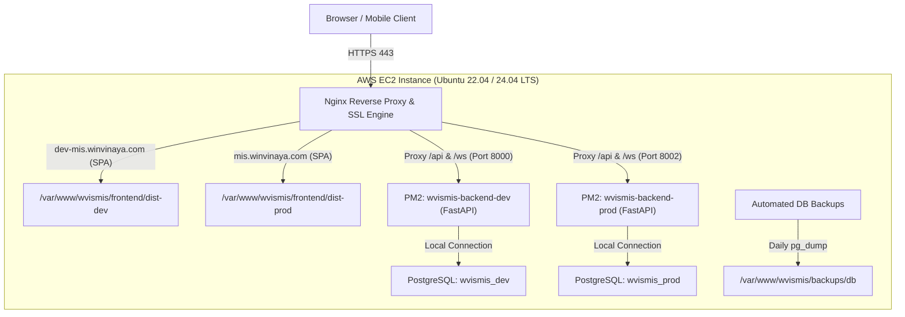

# WinVinaya MIS (WVISMIS) - EC2 Deployment Guide & Architecture

This runbook documents the deployment, operation, and maintenance of **WinVinaya MIS** (Backend, Frontend, and PostgreSQL Database) on an **AWS EC2** instance.

---

## 🏛️ Deployment Architecture



---

## 📋 Environment & Port Allocation

| Component                 | Development                          | Production                            |
| :------------------------ | :----------------------------------- | :------------------------------------ |
| **Domain**                | `dev-mis.winvinaya.com`              | `mis.winvinaya.com`                   |
| **Frontend Root**         | `/var/www/wvismis/frontend/dist-dev` | `/var/www/wvismis/frontend/dist-prod` |
| **Backend Internal Port** | `8000`                               | `8002`                                |
| **PM2 Process Name**      | `wvismis-backend-dev`                | `wvismis-backend-prod`                |
| **Backend Config**        | `/var/www/wvismis/backend/.env.dev`  | `/var/www/wvismis/backend/.env.prod`  |
| **Database Name**         | `wvismis_dev`                        | `wvismis_prod`                        |
| **Database User**         | `wvismis_user`                       | `wvismis_user`                        |

---

## 🚀 Step 1: AWS EC2 Instance Provisioning

1. **Recommended EC2 Instance Specs**:
   - **AMI**: Ubuntu Server 22.04 LTS or 24.04 LTS (64-bit x86)
   - **Instance Type**: `t3.small` (minimum, 2 vCPU, 2GB RAM) or `t3.medium` (recommended, 2 vCPU, 4GB RAM)
   - **Storage**: 30GB to 50GB gp3 SSD
   - **Elastic IP**: Allocate and attach an Elastic IP so your public IP never changes upon instance reboot.

2. **Security Group Rules (Inbound)**:
   | Type | Protocol | Port Range | Source | Purpose |
   | :--- | :--- | :--- | :--- | :--- |
   | **SSH** | TCP | `22` | Your IP / Bastion | Secure shell access |
   | **HTTP** | TCP | `80` | `0.0.0.0/0` | Let's Encrypt validation & HTTP redirect |
   | **HTTPS** | TCP | `443` | `0.0.0.0/0` | Secure SSL traffic |

3. **DNS Configuration (Route53 / Domain Registrar)**:
   - Add **A Record**: `dev-mis.winvinaya.com` -> `YOUR_EC2_ELASTIC_IP`
   - Add **A Record**: `mis.winvinaya.com` -> `YOUR_EC2_ELASTIC_IP`
   - Add **CNAME Record**: `www.mis.winvinaya.com` -> `mis.winvinaya.com`

---

## 🛠️ Step 2: Server Initial Provisioning

1. SSH into the instance:

   ```bash
   ssh -i your-key.pem ubuntu@YOUR_EC2_ELASTIC_IP
   ```

2. Clone the repository into `/var/www/wvismis`:

   ```bash
   sudo mkdir -p /var/www/wvismis
   sudo chown -R $USER:$USER /var/www/wvismis
   git clone <YOUR_GIT_REPOSITORY_URL> /var/www/wvismis
   cd /var/www/wvismis
   ```

3. Make all deployment scripts executable:

   ```bash
   chmod +x deploy/*.sh
   ```

4. Run the automated server setup script:
   ```bash
   sudo ./deploy/setup-ec2.sh
   ```
   _This automatically provisions Python 3.11, Node.js 20 LTS, PM2, PostgreSQL 16, Nginx, Certbot, 4GB Swap space, and UFW firewall._

---

## ⚙️ Step 3: Environment Configuration

### Backend Environment Configuration

1. **For Development (`backend/.env.dev`)**:

   ```bash
   cp backend/.env.dev.example backend/.env.dev
   nano backend/.env.dev
   ```

   _Verify:_
   - `PORT=8000`
   - `POSTGRES_DB=wvismis_dev`
   - `POSTGRES_USER=wvismis_user`
   - `POSTGRES_PASSWORD=WinVinayaDb#2026`
   - `BACKEND_CORS_ORIGINS=https://dev-mis.winvinaya.com,http://localhost:5173`
   - `SMTP_USER=no-reply@winvinaya.com`
   - `SMTP_PASSWORD=Admin##2025@`

2. **For Production (`backend/.env.prod`)**:
   ```bash
   cp backend/.env.prod.example backend/.env.prod
   nano backend/.env.prod
   ```
   _Verify:_
   - `PORT=8002`
   - `POSTGRES_DB=wvismis_prod`
   - `POSTGRES_USER=wvismis_user`
   - `POSTGRES_PASSWORD=WinVinayaDb#2026`
   - `BACKEND_CORS_ORIGINS=https://mis.winvinaya.com,https://www.mis.winvinaya.com`
   - Generate strong secret key: `openssl rand -hex 32`

### Frontend Environment Configuration

1. **For Development (`frontend/.env.dev`)**:

   ```bash
   cat << 'EOF' > frontend/.env.dev
   VITE_API_URL=https://dev-mis.winvinaya.com
   VITE_ENVIRONMENT=development
   EOF
   ```

2. **For Production (`frontend/.env.prod`)**:
   ```bash
   cat << 'EOF' > frontend/.env.prod
   VITE_API_URL=https://mis.winvinaya.com
   VITE_ENVIRONMENT=production
   EOF
   ```

---

## 🌐 Step 4: Configure Nginx & SSL

1. Link Nginx site configuration files:

   ```bash
   sudo cp nginx/dev.conf /etc/nginx/sites-available/wvismis-dev.conf
   sudo cp nginx/prod.conf /etc/nginx/sites-available/wvismis-prod.conf

   sudo ln -sf /etc/nginx/sites-available/wvismis-dev.conf /etc/nginx/sites-enabled/
   sudo ln -sf /etc/nginx/sites-available/wvismis-prod.conf /etc/nginx/sites-enabled/

   sudo nginx -t
   sudo systemctl reload nginx
   ```

2. Obtain free Let's Encrypt SSL certificates (run once DNS points to the EC2 Elastic IP):
   ```bash
   sudo ./deploy/setup-ssl.sh both
   ```
   _(Or run `sudo ./deploy/setup-ssl.sh dev` or `sudo ./deploy/setup-ssl.sh prod` individually)._

---

## 🚀 Step 5: Deploying the Application

### Deploy Development Environment:

```bash
cd /var/www/wvismis
./deploy/deploy-all.sh dev
```

### Deploy Production Environment:

```bash
cd /var/www/wvismis
./deploy/deploy-all.sh prod
```

---

## 🔍 Individual Operational Scripts

| Script               | Purpose                                     | Example Usage                                  |
| :------------------- | :------------------------------------------ | :--------------------------------------------- |
| `deploy-all.sh`      | Full build, migration, and deploy           | `./deploy/deploy-all.sh {dev\|prod}`           |
| `backend-deploy.sh`  | Deploy backend & run Alembic migrations     | `./deploy/backend-deploy.sh {dev\|prod}`       |
| `frontend-deploy.sh` | Build React & reload Nginx                  | `./deploy/frontend-deploy.sh {dev\|prod}`      |
| `health-check.sh`    | Run system & database health checks         | `./deploy/health-check.sh {dev\|prod}`         |
| `backup-db.sh`       | Manual/cron database backup                 | `./deploy/backup-db.sh {dev\|prod}`            |
| `restore-db.sh`      | Restore database from backup                | `./deploy/restore-db.sh {dev\|prod}`           |
| `rollback.sh`        | Rollback code & database to previous commit | `./deploy/rollback.sh {dev\|prod}`             |
| `setup-ssl.sh`       | Obtain and configure Let's Encrypt SSL      | `sudo ./deploy/setup-ssl.sh {dev\|prod\|both}` |

---

## 🔄 Automated Nightly Database Backup Cronjob

To automate nightly backups at 2:00 AM:

```bash
crontab -e
```

Add the following lines:

```cron
# Daily DB Backups for WinVinaya MIS at 2:00 AM (Dev) and 2:30 AM (Prod)
0 2 * * * /var/www/wvismis/deploy/backup-db.sh dev >> /var/www/wvismis/logs/backup_cron.log 2>&1
30 2 * * * /var/www/wvismis/deploy/backup-db.sh prod >> /var/www/wvismis/logs/backup_cron.log 2>&1
```

---

## 🩺 Monitoring & Troubleshooting

- **Check PM2 Processes**:
  ```bash
  pm2 status
  pm2 logs wvismis-backend-dev
  pm2 logs wvismis-backend-prod
  ```
- **Check Nginx Status & Logs**:
  ```bash
  sudo nginx -t
  sudo tail -f /var/log/nginx/wvismis-dev-error.log
  sudo tail -f /var/log/nginx/wvismis-prod-error.log
  ```
- **Check PostgreSQL Service**:
  ```bash
  sudo systemctl status postgresql
  sudo -u postgres psql -c "\l"
  ```
- **Test Health Check Endpoints**:
  ```bash
  curl -i http://localhost:8000/health   # Dev Backend
  curl -i http://localhost:8002/health   # Prod Backend
  curl -i https://dev-mis.winvinaya.com/health
  curl -i https://mis.winvinaya.com/health
  ```
